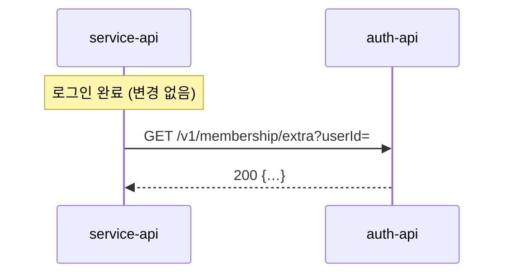
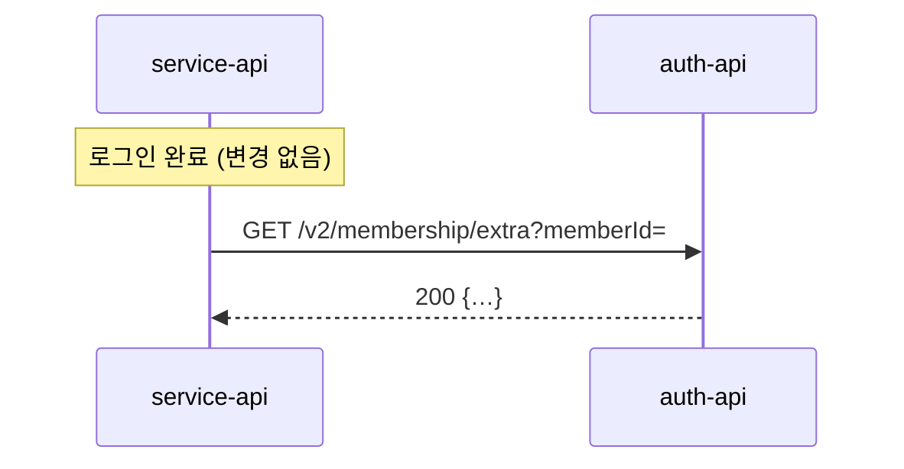

# 스펙 템플릿

frontmatter와 목차 순서는 고정이다 — 기계 계약이므로 필드 이름과 값 형식을 바꾸지 않는다. 본문 문장과 분량은 작업 크기에 맞게 조절한다. 필수 항목에 쓸 내용이 없으면 일반론으로 채우지 말고 `없음`이라고 쓴다.

이 파일은 **산출물의 모양**만 정한다. 저장 위치와 브랜치, 승인 조건, 승인 후 수정 규칙, status 전이는 spec-writer SKILL.md의 절차를 따른다. 스펙 하나는 애플리케이션 하나(따로 배포되고 담당자가 있는 단위)의 변경을 다룬다.

## 목차

- 템플릿 — frontmatter, 1 한눈에 보기, 2 범위, 3 확인한 사실과 가정, 4 외부 계약과 흐름, 5 성공 기준, 6 제약과 경계, 7 미해결 사항
- 작성 시 체크리스트

## 템플릿

````markdown
---
spec_id: <티켓 키>                  # 예: TICKET-123. 폴더명(docs/<티켓 키>/)과 같게 쓴다. 티켓이 없으면 YYYY-MM-DD-주제-kebab-case
ticket: <스펙 티켓 키>               # 에픽일 때 스펙 작성 티켓이 따로 있으면. 없으면 이 줄을 지운다
title: <스펙 제목>
status: draft                # draft | approved | implemented | superseded. superseded 면 본문 첫 줄에 "대체: <새 spec_id>"
created: <YYYY-MM-DD>
---

# <기능 또는 변경 이름>

## 1. 한눈에 보기

<이 절은 불렛 셋으로 끝낸다. 배경이 필요하면 2절 뒤나 부록에 둔다 — plan-executor의
`assemble_brief.py`가 이 절을 첫 `###` 전까지 잘라 실행자 브리프의 Goal로 쓴다.>

- 해결할 문제: <지금 무엇이 안 되거나 없는가>
- 바뀌는 결과: <이 작업이 끝나면 누구에게 무엇이 달라지는가>
- 완료 판단: <완료를 무엇으로 판별하는가 — 5의 성공 기준을 한 문장으로>

## 2. 범위

### 포함

- <이번에 하는 것>

### 제외

<이 소절과 6절은 `assemble_brief.py`가 제목 그대로 잘라 실행자 브리프의 Do not touch로 쓴다.
제목 문구를 바꾸면 스크립트 상단 상수도 함께 바꾼다.>

- <이번에 명시적으로 하지 않는 것>

## 3. 확인한 사실과 가정

<코드베이스에서 직접 확인한 것과 요구사항에서 추정한 것을 구분한다.>

| 구분 | 내용 | 근거 또는 확인 방법 |
|---|---|---|
| 확인값 | <코드·설정에서 실제 확인한 사실> | <파일 경로, 확인 명령> |
| 추정값 | <확인 못 한 가정. 수치 제안 포함> | <누가 어떻게 확정하는가> |
| 위험값 | <틀리면 설계가 바뀌는 값> | <확인 방법> |
| 깨지는 조건 | <이 스펙이 무효가 되는 전제 변화> | <감지 방법> |
| 확인값 또는 위험값 | 전제 환경: <6절이 요구하는 테스트 기반·도구·외부 환경이 저장소와 로컬에 있는가. 있으면 확인값, 없으면 위험값 `없음, 도입 필요`> | <확인 명령 또는 파일 경로> |

<6절이 테스트 기법·도구·외부 환경을 조건으로 지정하면 "전제 환경:"으로 시작하는 행을 반드시 하나 둔다.
있으면 확인값(경로·명령), 없으면 위험값 `없음, 도입 필요`다. 2026-10-17 측정에서 스펙이 `@DataJpaTest`를
조건으로 적었으나 저장소에 그 기반이 없었고, 확인 없이 쓴 계획이 실행 단계에서 멈췄다.>
## 4. 외부 계약과 흐름

<이 변경이 다른 시스템과 주고받는 API·이벤트·스키마를 바꾸지 않으면 `해당 없음` 한 줄.
바꾸면 아래 소절 중 해당하는 것만 채운다. "내부 흐름"은 외부 계약과 무관하게 조건에 걸릴 때 추가한다.>

### 계약

<다른 시스템과의 약속. 스펙은 요구사항 접수 직후에 쓰므로 새 API는 아직 코드에 없다.
계약의 원본이 무엇인지 팀 방식을 적는다.
- 계약 우선: 손으로 쓴 OpenAPI·proto·스키마 파일을 이 스펙과 함께 커밋. 파일이 원본, 아래 표는 요약.
- 코드 우선(springdoc 등 생성 문서): 구현 전까지 아래 표가 원본. 구현 PR에서 생성 문서를
  파일로 스냅샷 커밋(예: `docs/contract/openapi.json`)하고 "생성 결과 == 파일" 테스트를 붙인다.
  그 뒤로는 파일이 원본이고 spec-conformance-check가 표와 파일을 대조한다.>

- 계약 방식: <계약 우선 | 코드 우선>
- 계약 파일: <계약 우선이면 경로@버전. 코드 우선이면 `구현 PR에서 스냅샷 생성 예정: <경로>`>

| 항목 | 제공 측 | 소비 측 | 내용 |
|---|---|---|---|
| <예: GET /v2/membership/extra> | <이 애플리케이션> | <service-api> | <요청 파라미터, 응답 형식, 에러 코드> |
| <예: 기존 GET /v1/... 처리> | <이 애플리케이션> | <service-api> | <유지 기한 또는 삭제 시점> |

### 호출 흐름 (변경 전/후)

<시스템 경계를 건너는 호출 순서를 변경 전과 후로 나란히. 규칙:
- 바뀌는 경로만 그린다. 바뀌지 않는 앞뒤 구간은 노드 하나로 접는다.
- 노드는 시스템과 API 엔드포인트까지. 내부 클래스·메소드는 그리지 않는다.
- 화살표의 엔드포인트 이름은 위 계약 표와 같게 쓴다.
- Mermaid 텍스트로 쓴다. 그림이 필요 없는 계약이면 `해당 없음`.>

**변경 전**



**변경 후**



### 내부 흐름

<아래 넷 중 하나에 걸릴 때만 이 소절을 만든다. 아니면 만들지 않는다.
- 상태 전이가 있다 (전이마다 허용 동작이 다름)
- 비동기·이벤트가 끼어 있다
- 캐시 갱신 순서가 정확성을 결정한다
- 트랜잭션 경계가 메소드 여럿에 걸친다
수준은 컴포넌트까지. 상태 전이면 stateDiagram, 나머지는 sequenceDiagram 또는 flowchart. Mermaid 텍스트.>

### 배포 순서

<계약 상대와 배포 순서가 얽히면 어느 쪽이 먼저 배포되어야 하고, 그 사이 기간에 시스템이 어떻게 동작해야 하는지.
예: "이 애플리케이션 먼저. 전환 완료까지 기존 API 유지. 소비 측 배포 후 기존 API 제거는 별도 작업.">

## 5. 성공 기준

<완료를 판별하는 구체적·검증 가능한 조건. 기준은 기능 영역 하나씩 **묶음**으로 나누고,
각 기준은 그 아래 한 문장으로 쓴다. **식별자를 붙이지 않는다 — 기준 문장 자체가 키다.**
이 문장이 task-breakdown 추적성 표의 키이자 spec-conformance-check의 검증 단위다. 각 기준은
테스트로 옮길 수 있는 형태로 쓴다 (tdd 스킬 출처 ①).

식별자를 쓰지 않는 이유 — 번호는 손으로 지켜야 유지되고, 어긋나도 유효해 보인다. 전역
순번(SC-1, SC-2…)은 합본할 때 번호가 밀려 테스트·리포트·ADR 참조가 한꺼번에 어긋났다.
묶음별 번호(`§A-1` 등)도 삭제할 때 줄을 남기고 합본할 때 미사용 글자를 확인해야 유지되는데,
그 규율은 기계가 강제하지 않는다. 문장을 키로 쓰면 규율이 없어지고, 어긋나면 눈에 띈다:
- 기준을 추가하면 묶음 끝에 문장을 붙이고, 없어지면 줄을 지운다. 표시를 남기지 않는다.
- 합본(여러 스펙을 통합 스펙 하나로 합치기)은 묶음별로 목록을 합친다. 같은 묶음 이름이
  양쪽에 있으면 하나로 합치고 기준 문장은 그대로 옮긴다. 조정할 번호가 없다.
- 기준 문장을 고치면 계획의 추적성 표와 검증 리포트의 해당 행도 같이 고친다. 승인된 스펙의
  기준을 고치는 것은 계약 변경이므로 원래 절차를 탄다.
- 다른 스펙은 묶음 단위로 `<spec_id>#<묶음 제목>`(마크다운 앵커)으로 가리키고, 기준 하나를
  특정해야 하면 그 문장을 인용한다.
- 기준 문장을 서로 구별할 수 없을 만큼 비슷하게 쓰지 않는다. 구별이 안 되면 그 둘은
  중복이거나 모호한 기준이다.
- 테스트 이름(`@DisplayName`, 테스트 함수 이름)도 같은 원칙이다. 무엇을 검증하는지 서술하고
  (tdd 스킬), 기준 ↔ 테스트 연결은 계획(PLAN.md)의 추적성 표가 담당한다.>

### <묶음 이름 — 기능 영역 하나. 예: 부가 정보 조회/저장>

- <주어진 상태 또는 입력 → 기대 결과>
- <주어진 상태 또는 입력 → 기대 결과>

### <묶음 이름>

- <주어진 상태 또는 입력 → 기대 결과>

## 6. 제약과 경계

- 지켜야 할 조건: <예: 기존 네이밍 컨벤션 준수, 커밋 전 테스트. 테스트 기법·도구를 지정하면 3절 "전제 환경" 행에 그 존재 여부를 적는다>
- 사용자 확인이 필요한 변경: <예: DB 스키마 변경, 의존성 추가>
- 하지 않을 것: <예: 기존 API 시그니처 변경, 무관한 리팩토링>

## 7. 미해결 사항

- <사람의 입력이 필요한 미결 사항. 없으면 "없음">
````

## 작성 시 체크리스트

- [ ] `spec_id`가 폴더명(티켓 키)과 같고 파일명이 `spec.md`인가
- [ ] 4절이 맞는가 — 외부 계약이 없으면 `해당 없음`, 있으면 계약 방식과 계약 파일 항목이 채워졌는가
- [ ] 호출 흐름이 바뀌는 경로만, 시스템·엔드포인트 수준까지만이고, 엔드포인트 이름이 계약 표와 같은가
- [ ] 내부 흐름을 그렸다면 네 조건 중 어디에 걸리는지 말할 수 있는가
- [ ] 성공 기준이 묶음(`### <묶음 이름>`) 아래 문장으로 적혔고 식별자(SC-N, `§A-1` 등)를 붙이지 않았는가
- [ ] 기준 문장끼리 서로 구별되는가 (거의 같은 문장 둘이 없는가)
- [ ] 다른 스펙은 묶음 앵커로 가리키거나 기준 문장을 인용했는가
- [ ] 6절이 요구한 테스트 기반·도구가 저장소에 있는지 3절 "전제 환경" 행에서 확인했는가 (없으면 `없음, 도입 필요`로 적었는가)
- [ ] 빈 필수 항목을 일반론으로 채우지 않고 `없음`으로 뒀는가
